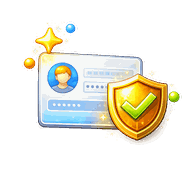
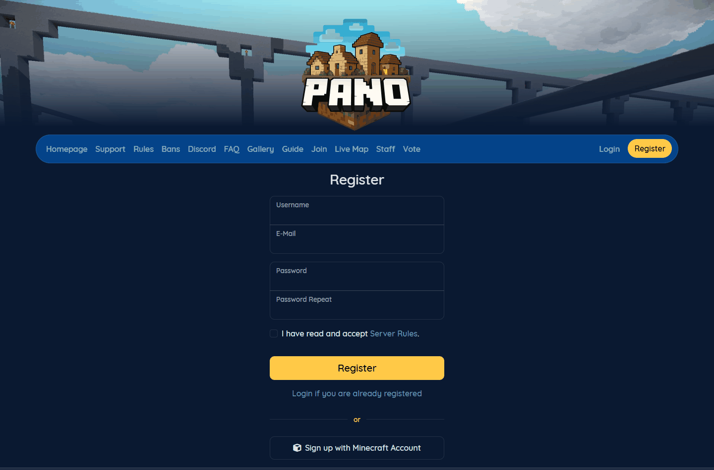
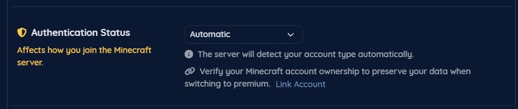
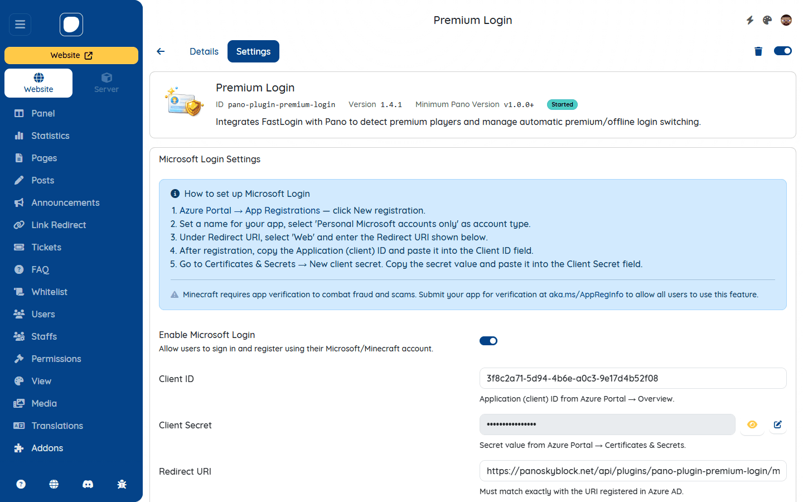

  
  <h1>Premium Login</h1>
  
<b>Let premium players join without a password, and keep offline players safe.</b>

  

    
    
    
  

Premium Login lets players who own Minecraft join your server without typing a password, while players on offline accounts still log in as usual. Players pick their account type on your website, and they can sign in or sign up there with their Minecraft account too. Your staff can see and change each player's status right from the panel.

## ✨ Features
- ⚡ **Auto-login for premium players**: Players with a paid Minecraft account join your server without a password.
- 🔄 **Premium, cracked or automatic**: Each player chooses their account type, or lets the server detect it.
- 🟩 **Sign in with Minecraft**: Players sign in or create an account on your website with their Minecraft account.
- 🔗 **Link a premium account**: Players prove they own their Minecraft account and keep their data when they switch to premium.
- 🏷️ **Fair usernames**: If a premium player claims a name, the other player gets a simple page to pick a new one.
- 🛠️ **Staff controls**: View, change or unlink a player's premium status from their player page.
- 🌐 **Works on your network**: Supports Spigot, BungeeCord and Velocity servers with FastLogin.

## 📸 Screenshots

<i>Players choose how they join the server and link their premium account from their settings.</i>

<i>A step-by-step guide in the panel walks you through turning on Minecraft sign-in.</i>

## 🚀 Get started
1. Open your Pano panel and go to **Addons**.
2. Find **Premium Login** and click **Install**.
3. Install the plugin on your Minecraft server next to FastLogin, then open the addon's **Settings** tab to turn on Minecraft sign-in.

## 💬 Support
Questions or ideas? Join our [Discord](https://panomc.com/discord) or visit [panomc.com](https://panomc.com).

## 📄 License
Released under the MIT License.
